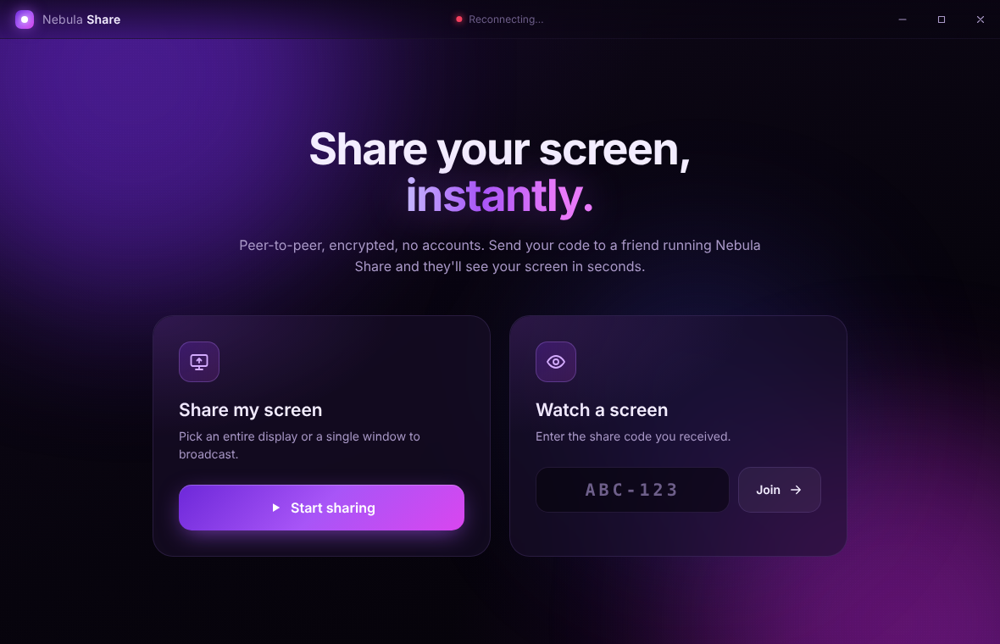
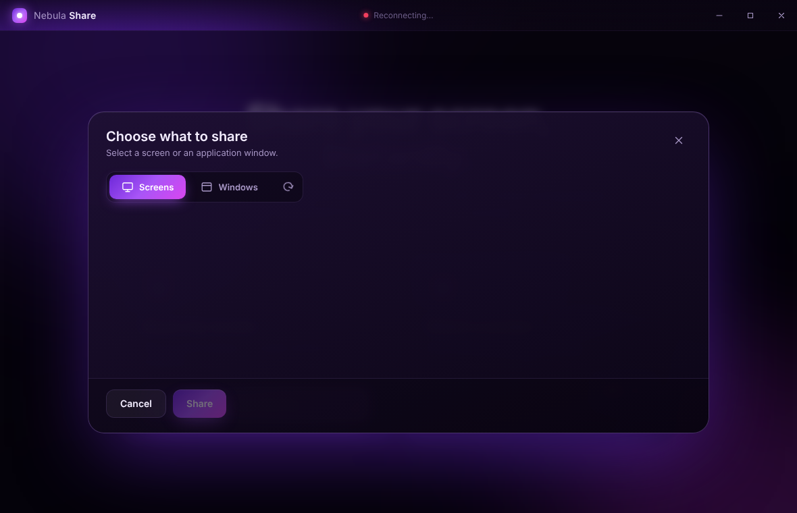
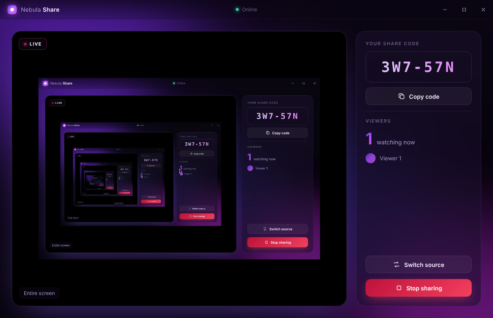

# Nebula Share

A Windows desktop app for peer-to-peer screen sharing. Click **Start sharing**, pick a whole screen or a single window, and send the 6-character code to a friend. They enter it in their copy of Nebula Share and see your screen live.

- Choose an entire display or a single application window, with live thumbnails
- Optional system audio (Windows loopback capture)
- Several viewers can watch at once, and you can switch source without dropping them
- Peer-to-peer WebRTC, encrypted end to end (DTLS-SRTP). No accounts.
- Frameless purple and black UI with a custom title bar

| Home | Picker | Sharing |
|---|---|---|
|  |  |  |

## Download / build

**Prebuilt:** every push to `main` runs the *Build Windows app* GitHub Action. Download the `NebulaShare-windows` artifact from the run. It contains:

- `Nebula Share Setup x.y.z.exe`, the installer
- `NebulaShare-Portable-x.y.z.exe`, a single exe that needs no install

**Build it yourself** (Node.js 20+):

```bash
npm install
npm start            # run in development
npm run dist         # build installer + portable exe into dist/
```

`npm run dist` also works from Linux and macOS (no Wine needed).

## How it works

| Piece | Role |
|---|---|
| Electron `desktopCapturer` | Lists the screens and windows shown in the picker |
| `setDisplayMediaRequestHandler` | Hands the chosen source to `getDisplayMedia()` |
| [PeerJS](https://peerjs.com) | Signaling plus WebRTC media and data channels |

The sharer registers on the signaling server under an ID made from its share code. A viewer opens a data connection to that ID, and the sharer answers by calling the viewer with the screen stream. Video goes directly between the two PCs. If a direct path isn't possible, PeerJS's TURN relay carries it.

### Signaling server

By default the app uses the free public PeerJS cloud server (`0.peerjs.com`), so it works out of the box. To use your own server ([`peer`](https://github.com/peers/peerjs-server) on npm), set an environment variable before you launch the app:

```bat
set NEBULA_SIGNAL_URL=https://signal.example.com:443/peerjs
"Nebula Share.exe"
```

Everyone who wants to connect must use the same server.

## Notes

- The installer and exe are not code-signed. Windows SmartScreen may warn the first time you run them: choose *More info → Run anyway*.
- Allow the app through Windows Firewall if prompted.
