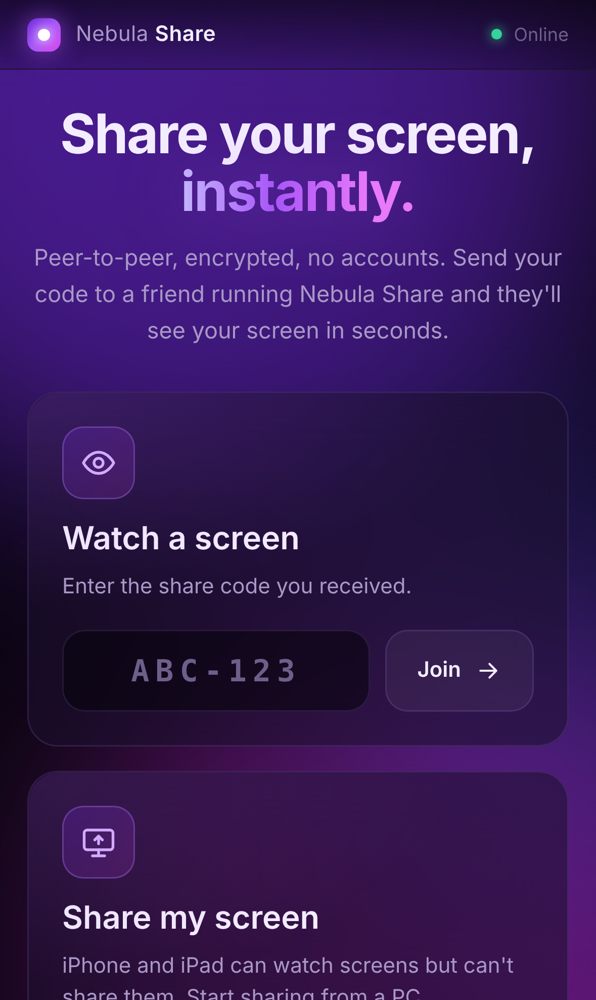
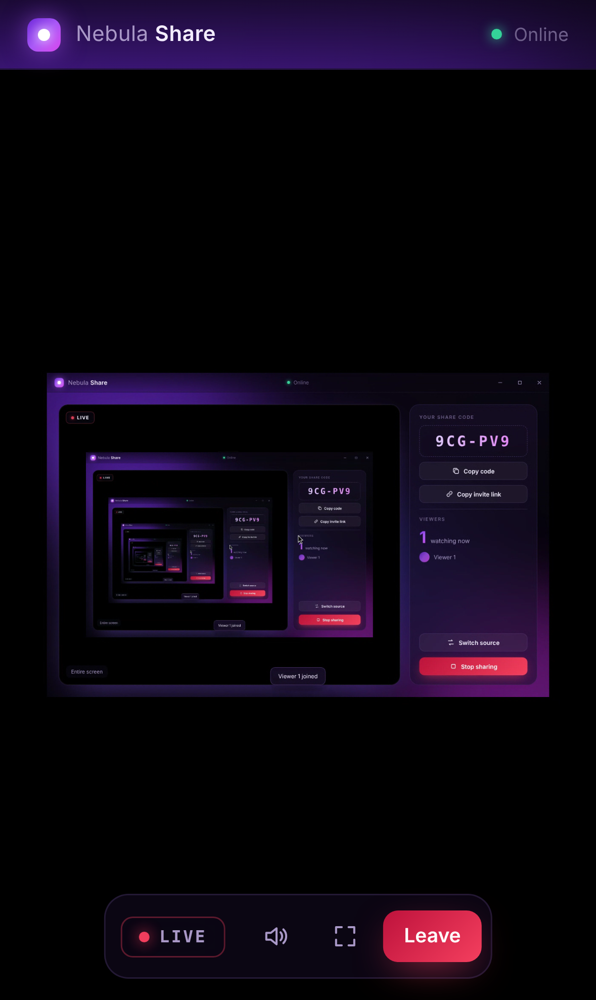

# Nebula Share

A peer-to-peer screen sharing app for Windows, with a companion web app for iPhone and iPad. Click **Start sharing**, pick a whole screen or a single window, and send the 6-character code to a friend. They enter it in their copy of Nebula Share and see your screen live.

- Choose an entire display or a single application window, with live thumbnails
- Optional system audio (Windows loopback capture)
- Several viewers can watch at once, and you can switch source without dropping them
- Peer-to-peer WebRTC, encrypted end to end (DTLS-SRTP). No accounts.
- Frameless purple and black UI with a custom title bar

| Home | Picker | Sharing |
|---|---|---|
|  |  |  |

## iPhone and iPad

The same app is published as an installable web app at **https://mvpfishstick.github.io/ScreenShare/**.

1. Open the link in **Safari** on the iPhone/iPad.
2. Tap **Share → Add to Home Screen**. Nebula then opens full screen like a normal app, with its own icon.
3. Enter the share code, or just tap an invite link from the sharer.

On the PC, **Copy invite link** copies a link like `…/ScreenShare/#join=ABC123` that opens the stream directly.

iOS lets apps *watch* a screen but doesn't let web apps capture the screen, so on iPhone/iPad the **Start sharing** button is disabled. Desktop browsers (Chrome, Edge, Firefox) can both share and watch from the same link.

| iPhone home | iPhone watching |
|---|---|
|  |  |

**First-time setup (repo owner, once):** in GitHub go to *Settings → Pages* and set **Source** to **GitHub Actions**. Every push to `main` then runs *Deploy web app* and publishes `dist-web/`. Build it locally with `npm run build:web`.

## Download / build (Windows)

**Download:** grab the latest version from the [**Releases page**](https://github.com/MVPFishstick/ScreenShare/releases/latest):

- `NebulaShare-Setup-x.y.z.exe`, the installer (recommended)
- `NebulaShare-Portable-x.y.z.exe`, a single exe that needs no install

**Publishing a new version:** bump `version` in `package.json`, then push a matching tag (`git tag v1.0.1 && git push origin v1.0.1`). The *Release* workflow builds both exes on Windows and publishes the release.

**Build it yourself** (Node.js 20+):

```bash
npm install
npm start            # run in development
npm run dist         # build installer + portable exe into dist/
```

`npm run dist` needs Windows (or Wine on Linux/macOS) for the installer. `npm run dist:portable` builds the portable exe from any OS.

## How it works

| Piece | Role |
|---|---|
| Electron `desktopCapturer` | Lists the screens and windows shown in the picker |
| `setDisplayMediaRequestHandler` | Hands the chosen source to `getDisplayMedia()` |
| [PeerJS](https://peerjs.com) | Signaling plus WebRTC media and data channels |

The sharer registers on the signaling server under an ID made from its share code. A viewer opens a data connection to that ID, and the sharer answers by calling the viewer with the screen stream. Video goes directly between the two PCs. If a direct path isn't possible, PeerJS's TURN relay carries it.

### Signaling server

By default the app uses the free public PeerJS cloud server (`0.peerjs.com`), so it works out of the box. To use your own server ([`peer`](https://github.com/peers/peerjs-server) on npm), set an environment variable before you launch the app:

```bat
set NEBULA_SIGNAL_URL=https://signal.example.com:443/peerjs
"Nebula Share.exe"
```

Everyone who wants to connect must use the same server.

## Notes

- The installer and exe are not code-signed. Windows SmartScreen may warn the first time you run them: choose *More info → Run anyway*.
- Allow the app through Windows Firewall if prompted.
